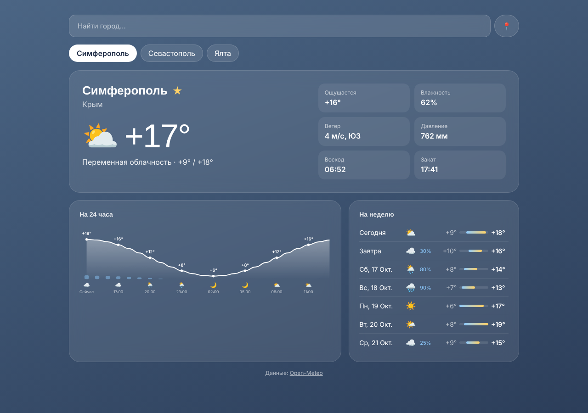

# Погода (Vue Weather)

Прогноз погоды по любому городу: текущие условия, график на сутки и прогноз на неделю. Фон страницы подстраивается под погоду.

**Демо:** https://danilromas.github.io/vue-weather/



## Возможности

- поиск города с подсказками (debounce + отмена устаревших запросов через `AbortController`)
- навигация по подсказкам с клавиатуры
- определение местоположения через Geolocation API
- график температуры и вероятности осадков на 24 часа — свой SVG, без библиотек графиков
- прогноз на 7 дней с полосками диапазона температур
- избранные города и последний выбранный город в `localStorage`
- защита от гонки запросов при быстром переключении городов

## Стек

Vue 3 (Composition API, composables), Vite, [Open-Meteo API](https://open-meteo.com) — бесплатный, без ключа.

## Запуск

```bash
npm install
npm run dev
```

## Структура

```
src/
  composables/
    useWeather.js     — загрузка прогноза, состояние загрузки и ошибок
    useFavorites.js   — избранные города
  components/
    CitySearch.vue    — поиск с автодополнением
    CurrentWeather.vue
    HourlyChart.vue   — SVG-график
    DailyForecast.vue
  utils/              — запросы к API, коды погоды WMO, форматирование
```
